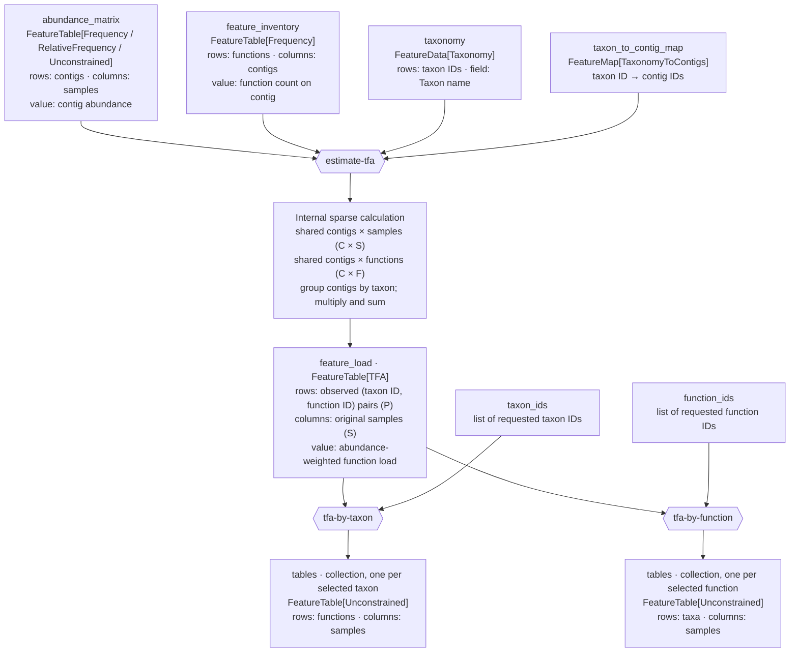

# q2-annotate

QIIME 2 plugin for functional annotation and taxonomic classification of shotgun metagenomes.

## Taxonomic functional attribution

`estimate-tfa` returns one sparse `FeatureTable[TFA]` (Taxonomic Functional
Attribution) artifact named `feature_load`. Its validated
`TFAFeatureTableDirFmt` stores a BIOM v2.1 sparse matrix. Its columns retain
the original sample IDs. Each row identifies one observed
taxon and functional feature pair, encoded as a JSON array of two strings
(for example, `["T1","bla_TEM"]`). The value for taxon *t*, function *f*,
and sample *s* is the sum, over contigs assigned to *t*, of the contig's
abundance in *s* multiplied by its count of *f*. Only pairs present in the
feature inventory are stored as rows; zero sample values remain sparse.

The schematic shows the axes of each table and how the three public actions
relate. Here, *C* is the number of shared, taxon-assigned contigs, *S* the
number of samples, *F* the number of functions, and *P* the number of stored
taxon/function pairs. The two selection actions run separately when requested;
`estimate-tfa` returns only `feature_load`.

Run `tfa-by-taxon` with a list of taxon IDs to obtain a collection containing
one function-by-sample table for each selected taxon. Run `tfa-by-function`
with a list of functional feature IDs to obtain one taxon-by-sample table per
selected function. These methods create artifacts only for requested IDs and
report unknown IDs as errors. Every collection member is a sparse
`FeatureTable[Unconstrained]`, since abundance-weighted loads may be
fractional. Collection keys use the original ID when it is a safe filename.
Other IDs use URL-safe base64 with an `id_` prefix; very long IDs use a
`hash_` prefix. The original IDs remain in `feature_load`.

The sample-resolved output replaces the older `estimate-tfa` layout, which
summed abundances across samples and used functional feature IDs as sample IDs.
Run `estimate-tfa` again from the original inputs to obtain per-sample loads;
the original layout cannot recover them.

## Installation
_q2-annotate_ is available as part of the QIIME 2 moshpit distribution. For installation and usage instructions please consult the official [QIIME 2 documentation](https://docs.qiime2.org).

## Functionality
This QIIME 2 plugin contains actions used to annotate and classify (meta)genomes:

| Action                    | Description                                                                            | Underlying tool       |
|---------------------------|----------------------------------------------------------------------------------------|-----------------------|
| build-custom-diamond-db   | Create a DIAMOND reference database from a FASTA input file.                           | [Diamond](https://github.com/bbuchfink/diamond) |
| build-eggnog-diamond-db   | Create a DIAMOND reference database for the specified taxon.                           | [Diamond](https://github.com/bbuchfink/diamond) |
| build-kraken-db           | Fetch an existing or build a custom Kraken 2 database.                                 | [Kraken 2](https://ccb.jhu.edu/software/kraken2/)      |
| classify-kaiju            | Classify reads using Kaiju.                                                            | [Kaiju](https://bioinformatics-centre.github.io/kaiju/) |
| classify-kraken2          | Classify reads/MAGs using Kraken 2.                                                    | [Kraken 2](https://ccb.jhu.edu/software/kraken2/)      |
| construct-pangenome-index | Construct the human pangenome Bowtie 2 index.                                          | [Bowtie 2](https://bowtie-bio.sourceforge.net/bowtie2/index.shtml) |
| estimate-bracken          | Perform read abundance re-estimation using Bracken.                                    | [Kraken 2](https://ccb.jhu.edu/software/bracken/) |
| estimate-tfa              | Estimate sample-resolved TFA as one sparse artifact. | - |
| extract-annotations       | Extract annotation frequencies from all annotations.                                   | - |
| fetch-diamond-db          | Fetch the complete Diamond database necessary to run the eggnog-diamond-search action. | [EggNOG mapper](https://github.com/eggnogdb/eggnog-mapper) |
| fetch-eggnog-db           | Fetch the databases necessary to run the eggnog-annotate action.                       | [EggNOG mapper](https://github.com/eggnogdb/eggnog-mapper) |
| fetch-eggnog-hmmer-db     | Fetch the taxon specific database necessary to run the eggnog-hmmer-search action.     | [EggNOG mapper](https://github.com/eggnogdb/eggnog-mapper) |
| fetch-eggnog-proteins     | Fetch the databases necessary to run the build-eggnog-diamond-db action.               | [EggNOG mapper](https://github.com/eggnogdb/eggnog-mapper) |
| fetch-kaiju-db            | Fetch Kaiju database.                                                                  | [Kaiju](https://bioinformatics-centre.github.io/kaiju/) |
| fetch-ncbi-taxonomy       | Fetch NCBI reference taxonomy.                                                         | [EggNOG mapper](https://github.com/eggnogdb/eggnog-mapper) |
| filter-kraken2-reads      | Filter Kraken 2-classified reads by taxonomy (for example, retain only bacterial reads). | - |
| filter-kraken2-results    | Filter Kraken 2 reports and outputs by metadata and/or abundance                       | - |
| filter-reads-pangenome    | Remove contaminating human reads.                                                      | [Bowtie 2](https://bowtie-bio.sourceforge.net/bowtie2/index.shtml) |
| inspect-kraken2-db        | Inspect a Kraken 2 database.                                                           | - |
| tfa-by-function           | Extract sparse taxon-by-sample tables for selected functions.                          | - |
| tfa-by-taxon              | Extract sparse function-by-sample tables for selected taxa.                            | - |
| kraken2-to-features       | Select downstream features from Kraken 2.                                              | - |
| kraken2-to-mag-features   | Select downstream MAG features from Kraken 2.                                          | - |
| map-eggnog                | Annotate orthologs against eggNOG database.                                            | [EggNOG mapper](https://github.com/eggnogdb/eggnog-mapper) |
| multiply-tables           | Multiply two feature tables.                                                           | - |
| predict-genes-prodigal    | Predict gene sequences from MAGs using Prodigal.                                       | [Prodigal](https://github.com/hyattpd/Prodigal) |
| search-orthologs-diamond  | Run eggNOG search using Diamond aligner.                                               | [EggNOG mapper](https://github.com/eggnogdb/eggnog-mapper) |
| search-orthologs-hmmer    | Run eggNOG search using HMMER aligner.                                                 | [EggNOG mapper](https://github.com/eggnogdb/eggnog-mapper) |
